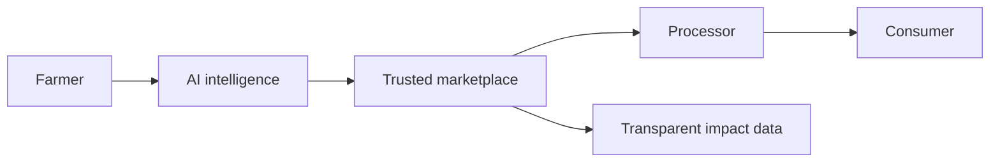
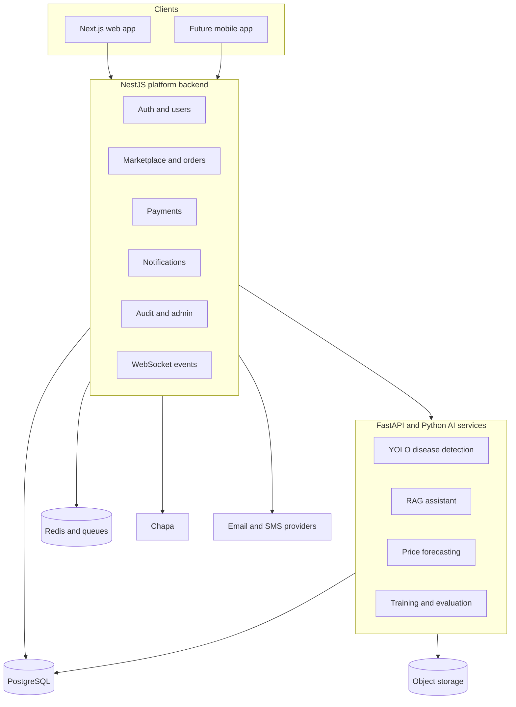

# AgroNexus AI

> **AI for the agricultural value chain in Ethiopia**
>
> Disease intelligence for farmers. Better market decisions. A transparent path from farm to processor.

AgroNexus AI is an AI-native platform concept and working prototype for connecting farmers, processors, and consumers across Ethiopia's agricultural value chain. It combines computer vision, retrieval-augmented generation, forecasting, and secure marketplace workflows in one product direction.

The project uses a clear separation of responsibilities:

- **Next.js** for the web experience
- **NestJS** for enterprise business workflows (auth, marketplace, orders, payments, notifications, audit)
- **FastAPI/Python** for AI and ML services
- **PostgreSQL, Redis, object storage, and asynchronous workers** for reliable infrastructure

> **Current status:** AgroNexus AI is a working AI-native platform for Ethiopia's agricultural value chain. It combines disease detection, chat assistance, price forecasting, quality grading, equipment marketplace, feasibility analysis, and secure marketplace workflows with role-based access control. The Next.js frontend communicates with the NestJS platform backend, which proxies authenticated AI requests to the FastAPI service. The system is containerized and ready for deployment to Render or Railway.

## Why AgroNexus AI?

Smallholder farmers and agro-processors often lack timely information about crop disease, market prices, quality, and reliable buyers. AgroNexus AI focuses on making those decisions more accessible while preserving a secure, auditable path for real transactions.

## Product vision



The first target product slice is intentionally narrow:

1. A verified farmer submits a crop image and receives a versioned disease-analysis result.
2. The farmer publishes a product listing.
3. A processor or consumer creates an order.
4. The order is paid through Chapa sandbox verification.
5. Notifications and audit events make the workflow traceable.

That target slice is implemented and tested end-to-end.

## Capabilities

| Capability | Status | Evidence / next boundary |
|---|---|---|
| Next.js role-based frontend | Implemented | Pages, a shared layout, and role-aware dashboards with English and Amharic localization |
| Marketplace listings and orders | Implemented (single source) | `backend/src/marketplace/` (NestJS) owns the domain; the FastAPI copy was deleted. The frontend calls `:4000/api/v1/marketplace/*`. |
| Authentication and authorization | Implemented | Admin role rejected at registration, order updates authorized on buyer/seller ID, startup-validated secret. Covered by 30 e2e tests plus 35 unit tests. |
| AI authentication | Implemented | Every browser-facing AI route proxies through NestJS, which mints `X-Internal-Service-Token` + `X-Internal-Service-User` per call. FastAPI's `internal_guard` verifies the signature and reads the role from the DB row. |
| Localization | Implemented | English and Amharic, switched from a language toggle in the header. Every string lives in the translation tables and a parity test fails the build when a locale is missing a key. |
| Configuration management | Implemented | `ai-service/app/core/config.py` is the single validated env surface; unknown values fail at startup |
| Frontend layout foundations | Implemented | Shared header and footer with design tokens, one header per page, an accessible button system, and 57 frontend tests |
| Frontend API migration | Implemented | Auth and all `/api/v1/*` calls go through NestJS (`:4000`); the six AI pages call the NestJS proxy |
| YOLO disease detection | Implemented | Real inference path against `data/models/disease-detection/v1/` with heuristic fallback for unknown cases |
| RAG agricultural assistant | Implemented | Gemini-powered chat with curated agricultural knowledge base in English and Amharic |
| Price and market features | Implemented | Prophet-based price forecasting with historical data stored in PostgreSQL |
| Chapa payments | Implemented | Chapa sandbox integration with server-side payment verification and webhook handling |
| Email/SMS notifications | Implemented | Email and SMS notification services integrated with template support |
| Email verification / password reset / SMS OTP | Implemented | Endpoints exist for email verification, password reset, and SMS/email OTP, all covered by the e2e suite. Tokens are stored only as hashes and are single-use. |
| Mobile application | Planned | Mobile client planned for future release |

### Security issues previously listed here

The two issues this section used to call out are **fixed and covered by tests**
in `tests/test_phase1_hardening.py`:

- ~~Public admin registration~~ — `UserRegister.role` now only accepts
  `farmer`, `processor`, or `consumer`; admin accounts must be provisioned
  server-side.
- ~~Order authorization by role name~~ — `update_order_status` compares the
  authenticated user against the order's actual `buyer_id` / `seller_id`.

New in the current work: `SECRET_KEY` is validated at startup (minimum 32
characters, no fallback), `ALGORITHM` is pinned to HMAC algorithms so a
misconfigured deployment cannot accept unsigned tokens, and the signing key is
read per request so rotating it invalidates existing tokens without a restart.


## Architecture



The browser never calls FastAPI directly. NestJS is the public business boundary; FastAPI is an authenticated internal AI service. Long-running inference, notifications, training, and reconciliation run through queues rather than blocking web requests.

## Documentation

| Document | Purpose |
|---|---|
| [01 - Product Overview](docs/01-product-overview.md) | Product vision, users, zones, boundaries, and success measures |
| [02 - Software Requirements Specification](docs/02-software-requirements-specification.md) | Functional, security, performance, and acceptance requirements |
| [03 - Software Design Specification](docs/03-software-design-specification.md) | Services, modules, APIs, security flows, and integration design |
| [04 - Database Design](docs/04-database-design.md) | Entities, columns, relationships, indexes, and state rules |
| [05 - UI/UX Specification](docs/05-ui-ux-specification.md) | User journeys, accessibility, localization, and frontend security |
| [06 - AI System](docs/06-ai-system.md) | Model lifecycle, RAG, evaluation, MLOps, and AI safety |
| [07 - Testing and Quality Assurance](docs/07-testing-and-quality-assurance.md) | Test pyramid, security tests, quality gates, and release evidence |
| [08 - Deployment and DevOps](docs/08-deployment-and-devops.md) | Environments, containers, CI/CD, secrets, observability, and recovery |
| [09 - Platform Decision Rule](docs/09-platform-decision-rule.md) | Why NestJS and FastAPI coexist and how migration is controlled |

## Repository structure

```text
agronexus-ai/
├── ai-service/           # FastAPI AI/business routes being refactored into `backend/`
├── backend/              # NestJS platform backend (auth, users, internal, marketplace, payments, notifications, sms)
├── frontend/             # Current Next.js application
├── mobile/               # Not started
├── data/                 # Local datasets and model artifacts
├── docs/                 # Product and engineering specifications (01-09)
├── tests/                # pytest suite for the ai-service
├── .github/workflows/    # CI, migration verification, image builds
├── docker-compose.yml    # Local PostgreSQL development services
└── README.md
```

The target migration layout is documented in [03 - Software Design Specification](docs/03-software-design-specification.md). It will be introduced incrementally after API contracts and tests are in place. `docs/IMPLEMENTATION-ROADMAP.md` tracks the current validated baseline and the re-ordered implementation phases.

## Cloud Deployment

The platform is ready for one-command deployment to Render or Railway via the included `docker-compose.yml`. Each service runs as a Docker container with health checks and non-root user configuration.

```bash
# Deploy to Render or Railway
docker compose up -d
```

Services:

| Service | Port | Purpose |
|---|---|---|
| Frontend (Next.js) | 3000 | Web application |
| Backend (NestJS) | 4000 | Business API and auth |
| AI Service (FastAPI) | 8000 | AI and ML inference |
| PostgreSQL | 5432 | Primary database |
| Redis | 6379 | Cache and queues |

[Live URL: Link will be provided after deployment]

## Local development

### Prerequisites

- Python 3.11+
- Node.js 18+
- Docker Desktop and Docker Compose
- Git

> **Use a virtual environment.** On a machine with more than one Python
> installed, a bare `uvicorn` can resolve to a different interpreter than
> `python`, which shows up as `ModuleNotFoundError` for packages that are in
> fact installed. Always run `python -m uvicorn` from inside the activated venv.

### Start the services

```bash
docker compose up -d postgres redis
```

### Configure the services

```bash
cd ai-service
cp .env.example .env
```

`SECRET_KEY` is required and must be at least 32 characters — generate one with
`python -c "import secrets; print(secrets.token_urlsafe(48))"`. The service
refuses to start without it rather than falling back to a default.

### Run the NestJS business backend

```bash
cd backend
npm install
copy .env.example .env   # Windows
# or: cp .env.example .env
npm run start:dev
```

The NestJS service owns identity, marketplace, orders, payments, notifications, and audit. It connects to PostgreSQL on `DB_HOST` and `DB_PORT` and never touches the database schema directly: `ai-service` owns it through Alembic.

### Run the Next.js frontend

```bash
cd frontend
npm install
cp .env.example .env.local
npm run dev
```

The frontend calls the NestJS service at `http://localhost:4000` for authentication, marketplace, and the AI proxy routes (`/api/v1/disease`, `/api/v1/prices`, `/api/v1/chat`, `/api/v1/quality`, `/api/v1/industry`, `/api/v1/equipment`); those are forwarded to ai-service (`:8000`) over an internal token that NestJS mints per request.

### Run the tests

```bash
# From the repository root
python -m pytest tests -q

# Verify migrations against a real database
docker compose up -d postgres
python -m alembic upgrade head
```

Useful local URLs:

- Frontend: `http://localhost:3000`
- Current FastAPI documentation: `http://localhost:8000/docs`
- Current health endpoint: `http://localhost:8000/health`
- pgAdmin: `http://localhost:5050`

Do not place real provider keys or personal data in the repository.

## Configuration reference

Every environment variable the FastAPI service reads is declared and validated
in [`ai-service/app/core/config.py`](ai-service/app/core/config.py). Modules call
`get_settings()` instead of `os.getenv`, so a missing or malformed value fails
once at startup with an actionable message rather than on a random request.

| Variable | Required | Purpose |
|---|---|---|
| `SECRET_KEY` | Yes | JWT signing key, minimum 32 characters. No default. |
| `DATABASE_URL` | No | PostgreSQL DSN. Defaults to `localhost:5436`. |
| `ALGORITHM` | No | JWT algorithm. Restricted to `HS256`/`HS384`/`HS512`. |
| `ACCESS_TOKEN_EXPIRE_MINUTES` | No | Token lifetime, default 1440. Must be positive. |
| `COOKIE_SECURE` | No | Adds the `Secure` flag to the auth cookie. Default `false` for local HTTP. |
| `CORS_ORIGINS` | No | Comma-separated allowed origins for the web client. |
| `GEMINI_API_KEY` | No | Enables the Gemini chat path; empty falls back to the keyword knowledge base. |
| `OPENWEATHER_API_KEY` | No | Empty returns a clear "not configured" response. |
| `MODEL_PATH`, `MODEL_VERSION` | No | Locate the disease-detection weights. |
| `CHAPA_*`, `EMAIL_*`, `SMS_*` | No | Provider credentials for payment and notification integrations. Empty means "not configured". |

`REDIS_URL` is intentionally not declared: Redis does not exist in
`docker-compose.yml` yet, and documenting an unused variable would imply wiring
that is not there.


## Security direction

The production design requires:

- No public self-registration as `admin`
- Strong startup-validated secrets
- Short-lived access sessions and rotating refresh tokens
- HTTP-only secure cookies for web and Bearer-token support for mobile
- Email verification, password reset, phone OTP, and rate limiting
- Server-side ownership checks for every order and listing action
- Chapa server-to-server payment verification and idempotent webhooks
- Private object storage with signed URLs
- Append-only audit logs and structured redacted logging
- Database migrations instead of production `create_all`

These are engineering requirements, not guarantees provided automatically by FastAPI or NestJS.


## Contributing

Use focused branches and conventional commits. Before opening a pull request:

```text
format -> lint -> type check -> tests -> security scan -> build
```

Changes should update the relevant document when they alter product behavior, security assumptions, data ownership, or deployment configuration.

## Author

**Tsegay Assefa** - AI/ML Engineer and Full-Stack Developer

- GitHub: [@TsegayIS122123](https://github.com/TsegayIS122123)
- LinkedIn: [tsegay-assefa-95a397336](https://linkedin.com/in/tsegay-assefa-95a397336)
- Email: tsegayassefa27@gmail.com

## License

MIT License
